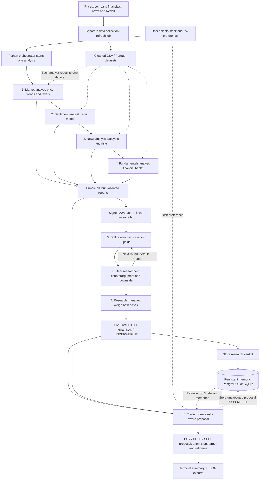

# KAIROS: project analysis and agent flow

Based on the source code inspected on 2026-11-16, updated after the JSONC configuration refactor. This describes implemented behavior rather than the older Phase 1 roadmap. External services and live model calls were not executed for this analysis.

## The simple explanation

KAIROS is a Python command-line equity research system for Indian stocks. It prepares data, asks four specialists to assess it, debates the positive and negative cases, and converts the verdict into a simulated trading proposal. Memory helps the trader consider previous research and recorded trade lessons.

**Collect → Analyze → Debate → Decide → Propose → Remember.**

There are **eight agent roles**: four analysts, two researchers, one research manager, and one trader. A Python orchestrator coordinates them; it is not another LLM agent. Default stocks are RELIANCE, TCS, INFY, HDFCBANK, and ICICIBANK.

## Agent flow diagram

The four analyst calls execute **sequentially**, in the numbered order above. The reports are independent inputs to the bundle; the arrows between analysts show execution order, not one analyst consuming another's report. The Bull/Bear loop is also sequential. Multiple stocks run one after another.

## What each agent does

| Agent | Input | Main job | Output |
| --- | --- | --- | --- |
| Market analyst | Historical daily bars and latest saved quote | Assess SMA, RSI, MACD, trend, support and resistance; validate price consistency | `MarketAnalysisReport` |
| Sentiment analyst | Cleaned Reddit posts | Count bullish/bearish sentiment, ticker relevance, themes and source provenance | `SentimentAnalysisReport` |
| News analyst | Cleaned financial articles | Identify catalysts, regulatory concerns and overall news sentiment | `NewsAnalysisReport` |
| Fundamentals analyst | Cleaned financial summary | Assess margins, debt, solvency and a heuristic valuation posture | `FundamentalsAnalysisReport` |
| Bull researcher | All four reports and debate context | Present upside thesis, catalysts and rebuttals | `BullThesis` |
| Bear researcher | All four reports and debate context | Present downside thesis, vulnerabilities and counterarguments | `BearThesis` |
| Research manager | Reports and debate tasks | Weigh competing cases and explain a recommendation | `ResearchSynthesisVerdict` |
| Trader | Reports, verdict, risk preference and memories | Generate direction, entry, stop-loss, target, sizing guidance, confidence and warnings | `TradingProposal` |

## How the project fits together

### 1. Entry points and orchestration

- [`main.py`](../main.py), [`run.py`](../run.py) and `python -m kairos` delegate to [`kairos/main.py`](../kairos/main.py).
- `kairos/main.py` provides an interactive stock/risk menu and flags such as `--ticker`, `--all`, `--risk` and `--trader-only`. The last option regenerates proposals from saved verdicts without rerunning analysts and debate.
- [`kairos_config/agents/`](../kairos_config/agents/) contains the eight JSONC identities (role, goal and backstory). [`tasks.jsonc`](../kairos_config/prompts/tasks.jsonc) contains ten task templates. Python retains calculations, schemas and dynamic debate context. See the [editing guide](project_structure.md).
- [`kairos/phase2_orchestrator.py`](../kairos/phase2_orchestrator.py) initializes the agents, runs the four analysts, bundles their reports, signs and dispatches the debate task, stores the verdict, and invokes the trader. `run_all()` repeats this per stock.

### 2. Data preparation is a separate workflow

- [`kairos/cli.py`](../kairos/cli.py) exposes data discovery, collection, validation and inventory commands.
- [`kairos/collectors/`](../kairos/collectors/) and [`kairos/mcp_client/`](../kairos/mcp_client/) acquire historical prices, saved latest quotes, news, fundamentals and Reddit content. The client has provider-specific live paths for Yahoo Finance, NSE and Alpha Vantage, plus a stdio path for other configured servers. It is not uniformly a remote MCP-server workflow.
- [`kairos/pipeline/refresh.py`](../kairos/pipeline/refresh.py) provides another refresh workflow; the older `dataphase1_logic` modules and `pipeline_live_refresh.py` are wrappers.
- [`kairos/pipeline/scheduler.py`](../kairos/pipeline/scheduler.py) periodically refreshes data; `scripts/scheduler.py` remains a compatibility launcher. By default it refreshes quotes, news and Reddit; historical prices are optional. It does not launch the agent analysis or refresh fundamentals.
- [`kairos/processors/`](../kairos/processors/) provides cleaning, deduplication, privacy redaction, indicator computation and market validation. [`kairos/validation/quality_checks.py`](../kairos/validation/quality_checks.py) creates quality reports and quarantine information.
- [`kairos/storage/`](../kairos/storage/) handles raw JSON, cleaned CSV/Parquet, manifests and optional database storage.

**Important:** running `main.py` does not automatically collect fresh data. Analysts load saved Parquet files first, then CSV. Required missing or empty datasets can stop analysis.

### 3. Analysis and model execution

[`kairos/agents/adk_analysts/`](../kairos/agents/adk_analysts/) contains the four specialist implementations and their shared base. Each builds a rule-based report from saved data, optionally asks a model to synthesize a structured report, then validates the result.

The source labels these agents “Google ADK,” but the inspected base calls an OpenAI-compatible client for Groq and `google.genai` for Gemini directly. It does not run a Google ADK agent/runner workflow. Groq is preferred when its client is available; Gemini is used in the alternative branch when Groq is unavailable. A failed Groq attempt can return a deterministic report without trying Gemini.

[`kairos/agents/crewai_research/`](../kairos/agents/crewai_research/) constructs real CrewAI agents and sequential tasks. For N rounds it creates N Bull tasks, N Bear tasks, and one final manager task. The default is two rounds, configurable through `KAIROS_DEBATE_ROUNDS` or `DEBATE_ROUNDS`. Without successful model execution it generates a deterministic debate and verdict explicitly labeled `DETERMINISTIC_FALLBACK`.

Model fallback is different from mock market data: the MCP client restricts synthetic data fallback to explicitly enabled/test conditions, and market/trader code also checks synthetic provenance.

### 4. Communication and checks

- [`kairos/a2a/contract.py`](../kairos/a2a/contract.py) defines typed task/response envelopes, trace IDs and HMAC signing.
- [`kairos/a2a/broker.py`](../kairos/a2a/broker.py) synchronously invokes registered Python handlers and records an in-memory audit trail. It is a local hub, not a deployed network of independently running agent services.
- The main path sends **one bundled debate request**, rather than four separate analyst-to-researcher network messages. The trader is invoked directly by the orchestrator.
- [`kairos/observability/`](../kairos/observability/) provides traces, lifecycle callbacks, schema checks, evidence checks and freshness checks. Analyst guardrail failures raise errors; a failed debate dispatch stops that ticker's pipeline. Memory write failures are logged and do not necessarily stop proposal generation.

### 5. Memory and feedback

[`kairos/memory/storage.py`](../kairos/memory/storage.py) selects PostgreSQL when available, otherwise SQLite. Writes through the manager are mirrored locally when PostgreSQL is active. Retrieval ranks candidate records by relevance and recency; the trader requests three memories using the current stock, inferred market conditions and strategy.

The main analysis calls `MemoryManager` directly. [`kairos/memory/mcp_server.py`](../kairos/memory/mcp_server.py) separately exposes memory operations as FastMCP tools; the main flow does not require a memory-server round trip.

Memory distinguishes research runs, hypothetical proposals and completed trades. New proposals remain PENDING with no fabricated profit/loss. The database can be populated with hardcoded seed trade records; these should not be interpreted as evidence of broker-verified executions. The vectors are deterministic 16-dimensional character-based pseudo-embeddings, not embeddings from a semantic model. Recorded trade lessons can affect the rule-based trader's confidence and stop buffer; there is no automatic model training or broker outcome ingestion loop.

### 6. Results

The standard runner prints the debate, proposal details and a plain-English summary, and writes:

- `data/processed/phase2_verdicts.json`: reports, verdict and proposal per stock.
- `data/processed/research_debate.json`: debate rounds and manager verdict.
- `data/processed/trading_proposals.json`: structured proposals.
- `data/processed/memory_audit.json`: memory status and recent local records.

The proposal schema includes direction, entry price, stop-loss, target, risk/reward, confidence, time horizon, rationale, risk preference and sizing guidance. **The implemented flow ends with a simulated proposal. There is no live order placement.**

## Findings to keep in mind

1. **Historical documentation lags implementation.** The archived Phase 1 README describes debate agents as future work. The Phase 1 “no custom MCP server” statement also predates the memory MCP server. The main README now describes the current application.
2. **Runtime dependencies and configuration are now packaged.** The refactor declares CrewAI, the OpenAI-compatible SDK, Google GenAI, appdirs and JSON5, and includes JSONC resources in wheels. Shared research runtime setup also allows construction without model credentials so the rule-based fallback can run.
3. **Freshness enforcement needs attention.** `FreshnessGuardrail` has a `max_days_stale` setting but does not actually reject old dates in its current implementation. Several reports and refresh messages also contain fixed October 2026 dates/status strings. A freshness label is not proof of current data.
4. **Some transport security is conditional.** The orchestrator signs its debate request, but the broker verifies signatures only when a signature is present. Its default secret is hardcoded. This matters if the local hub is later exposed across a trust boundary.
5. **Memory is a heuristic context store.** Seed records and pseudo-embeddings make it suitable to demonstrate feedback, but do not establish learned trading performance or semantic retrieval quality.
6. **Research heuristics are simplified.** For example, the deterministic fundamentals analyst infers “undervalued” partly from profitability and leverage. That label is not a complete market-price valuation model.

## Source map

| Area | Primary source |
| --- | --- |
| User controls and exports | [`kairos/main.py`](../kairos/main.py) |
| Actual execution order | [`kairos/phase2_orchestrator.py`](../kairos/phase2_orchestrator.py) |
| Shared analyst model execution | [`base_analyst.py`](../kairos/agents/adk_analysts/base_analyst.py) |
| Debate loop and fallback | [`research_crew.py`](../kairos/agents/crewai_research/research_crew.py) |
| Proposal generation and memory feedback | [`trader_agent.py`](../kairos/agents/trader_agent.py) |
| Output contracts | [`analyst_reports.py`](../kairos/schemas/analyst_reports.py), [`trading_proposal.py`](../kairos/schemas/trading_proposal.py) |
| Persistent context | [`memory/storage.py`](../kairos/memory/storage.py), [`memory/recency.py`](../kairos/memory/recency.py) |
| Existing verification coverage | [`tests/`](../tests/) — schemas, processors, collectors, quality, MCP, analysts, debate, memory and trader |

## Review scope

The original review was a static architectural analysis. The subsequent refactor added JSONC-driven agent/task definitions, package entry points, organized pipeline/diagnostic modules and configuration tests. Agent/configuration tests run in an isolated project copy; existing research datasets are preserved. Live integrations and financial data accuracy remain outside that verification. See the project README for test commands.

## Current runtime implementation

The Market Analyst is an actual Google ADK `BaseAgent` workflow executed by `Runner`, with an optional `LlmAgent` explanation step. Its ADK session state carries both MCP tool outputs and the grounded report. The other three specialists are Python analyzers; their historical directory/name does not imply separate ADK agents. CrewAI owns Bull/Bear/manager tasks. No additional agent framework is introduced.

The default handoff uses the standard `a2a-sdk` AgentCard and JSON-RPC client/server, with Pydantic reports. The older signed-envelope hub remains only for compatibility. Frontend SSE is a separate monitoring transport, not a claim that A2A itself streams.

New web runs fetch fresh financial statements, verified recent news and sentiment into a run-specific evidence directory before analysis. Market MCP calls fetch live history/quotes. A failed fresh source is shown as a failure, never relabeled archived evidence. The UI exposes actual agent starts, state changes, validated outputs, CrewAI contribution drafts and completed arguments. Draft text is explicitly unvalidated.

The proposal is advisory. A separate MegaBull preview resolves the selected NSE/BSE listing, displays the exact virtual order, and requires explicit approval. Submissions are single-use and ambiguous provider outcomes require reconciliation.
